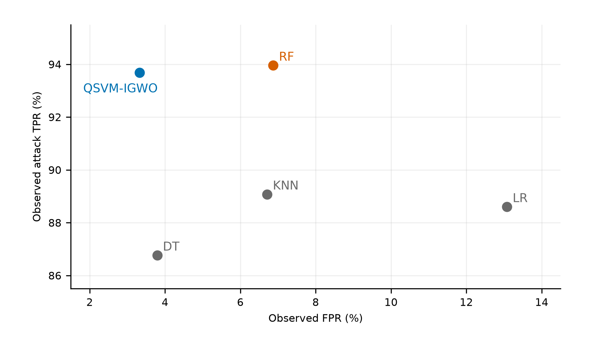

# QML-IDS Operating Points

**Source-linked reconstruction of false alarms and attack detection in a defined quantum machine learning corpus.**

[](https://github.com/roberto-fernandez-barrios/qml-ids-operating-points/actions/workflows/reproduce.yml)
[](https://doi.org/10.5281/zenodo.23642804)
[](LICENSE)
[](LICENSE-DATA)

This repository accompanies *False-Alarm Improvements and Detection Trade-Offs in QML Intrusion Detection: A Secondary Analysis of the Kaissar Corpus*, by Roberto Fernández-Barrios, Iker Pastor-López, Asier González-Santocildes and Pablo García Bringas, University of Deusto.

**Research question:** in the eligible studies of this corpus, what quantitative evidence can be recovered about false positives and attack detection at the **same operating point**, and how do evaluation size and threshold selection limit its interpretation?

The contribution is an empirical reconstruction of published evidence. It connects counts, denominators, source objects and evaluation provenance, using established statistical methods. The companion manuscript is prepared for submission; this repository does not claim journal acceptance or publication.

**For the article's exact reproducibility artifact, use [release 2.2.0](https://github.com/roberto-fernandez-barrios/qml-ids-operating-points/releases/tag/v2.2.0) or [Zenodo](https://doi.org/10.5281/zenodo.23642804).** The `main` branch adds reader documentation and continuous verification. Its documentation can evolve; the archived tag and ZIP stay unchanged. [Version policy](docs/VERSION_POLICY.md).

## What the reconstruction makes visible



*Published K17 Figure 7 Test matrices, reconstructed without combining them with training matrices or cross-validation means. Against random forest, the quantum support vector machine (QSVM) reduces false-positive rate (FPR) from **6.875% to 3.329%**, while true-positive rate (TPR) decreases from **93.955% to 93.682%**. Equal denominators do not establish paired observations. [Source](https://doi.org/10.1007/s10586-024-04458-8) · [Vector PDF](docs/assets/figure2_k17_tradeoff.pdf) · [All 24 points and provenance](docs/INTERPRETATION.md).*

Two further distinctions matter: K10's complete benign row identifies **12/6000 false positives (0.200%)** even though attack-side allocation needs additional assumptions for TPR; K07's normalized matrices identify ranges rather than a unique aggregate attack-detection rate. The analysis preserves favorable findings, trade-offs and unresolved provenance.

## Scope at a glance

| Unit | Number | Meaning |
|---|---:|---|
| Entries in the Kaissar frame | 25 | Previously selected by the review, including quality screening |
| Included articles / documentary families | 21 / 20 | Articles and related reports are different units |
| Articles with substantive methodology consulted | 15 | Access is not equivalent to reporting completeness |
| Articles contributing to the main figure | 5 | K03, K07, K10, K11 and K17 |
| Main descriptive points | 24 | Multiple points within a study are not independent studies |
| Main conditional illustrations | 6 | K10/K17; independence remains unverified |

The 466 database rows also include summary metrics and administrative/configuration records. They are **not 466 independent evaluations**. The results concern the [Kaissar corpus](https://doi.org/10.3390/fi18050234), not field-wide frequencies for quantum machine learning intrusion detection systems (QML-IDS).

## Reproduce

Download and extract the portable ZIP from [release 2.2.0](https://github.com/roberto-fernandez-barrios/qml-ids-operating-points/releases/tag/v2.2.0). From its root, with Python 3.12 or 3.13:

```bash
python -m venv .venv
# Activate: source .venv/bin/activate (Linux/macOS)
# Activate: .venv\Scripts\Activate.ps1 (Windows PowerShell)
python -m pip install -r requirements-tested.txt
python -B scripts/verify_package.py
python -B scripts/reproduce.py
```

The same commands work from a clone of `main`. Installation uses the network; reconstruction uses only the included derived records. No TeX, GPU, QPU, training, source-paper downloads or credentials are required.

Expected: **180 numerical/classification checks pass**, two scientific figures in PDF/SVG/PNG, LaTeX tables, structured results and `results/extraction_browser.html`. Open that HTML file locally to inspect the records and source links. See [reproduction instructions and troubleshooting](docs/REPRODUCIBILITY.md) for environments, output paths and what a successful check establishes.

## Reader's guide

| I want to… | Start here |
|---|---|
| Interpret the evidence and its limits | [Interpretation and full figure](docs/INTERPRETATION.md) |
| Reconstruct a figure or table | [Article-to-artifact map](docs/ARTIFACT_MAP.md) |
| Understand a record or missing value | [English data dictionary](docs/DATA_DICTIONARY.md) |
| Inspect selection and extraction rules | [English protocol guide](docs/EXTRACTION_PROTOCOL_EN.md) |
| Locate an original source | [Versioned source registry](data/SOURCE_REGISTRY.json) |
| Cite or reuse the artifact | [Citation](docs/CITING.md) · [Licensing scopes](LICENSING.txt) |
| Report an error or propose a correction | [Contribution guide](CONTRIBUTING.md) |

## Evidence and verification

Observed rates, identification/rounding ranges and conditional sampling calculations are distinct. K03 (reported test-based adjustments) and K11 (training-described results) retain descriptive rates; their intervals are hypothetical and supplementary. K10/K17 remain conditional illustrations with **unverified independence**. The 1%, 0.1% and 0.01% references are analytical scales, not operational targets imposed on the original authors.

The authors have completed human validation and approved the manuscript. An independent duplicate extraction by two researchers is **not claimed**. The [AI and review statement](docs/AI_AND_REVIEW.txt) describes the assistance and the technical checks. CI verifies arithmetic, documentation and preservation of the archived analysis; it does not establish source validity, sampling independence or deployment guarantees.

## Citation and reuse

Fernández-Barrios, R.; Pastor-López, I.; González-Santocildes, A.; García Bringas, P. **QML-IDS Operating Points: reproducibility artifact for the Kaissar corpus**, version 2.2.0. Zenodo. [doi:10.5281/zenodo.23642804](https://doi.org/10.5281/zenodo.23642804).

Code and verification tools: **MIT**. Derived data, documentation and reconstructed figures: **CC BY 4.0**. Original papers retain their own rights and are not redistributed. Cite the relevant original studies when reusing their observations; the archive DOI identifies this artifact, not an accepted journal article. [Machine-readable citation](CITATION.cff) · [Change history](CHANGELOG.md).
