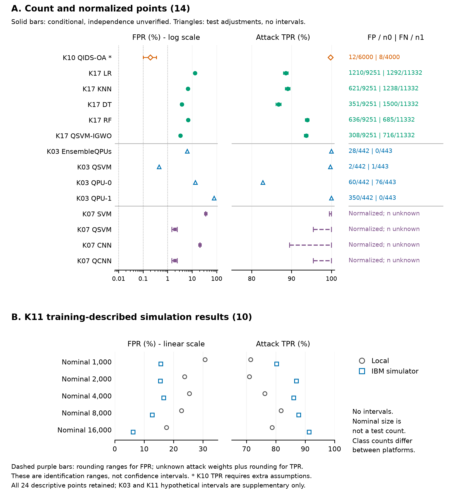

# Reading the reconstructed evidence

[Overview](../README.md) · [Data dictionary](DATA_DICTIONARY.md) · [Artifact map](ARTIFACT_MAP.md)

[Vector PDF](assets/figure1_operating_points.pdf) · [SVG](assets/figure1_operating_points.svg)

These are copies of the figures produced by artifact 2.2.0, not new analyses. The source identifiers below link each point to its original study.

## Five sources, different interpretive consequences

| Source | Recoverable evidence | Interpretation |
|---|---|---|
| [K03: Payares and Martinez-Santos](https://doi.org/10.1117/12.2593297), Section 3 and Figures 6–9 | Four matrices on 442 benign and 443 attack cases | The published QSVM has FPR 0.452% and TPR 99.774%. Reported adjustments after test inspection place intervals in a hypothetical tier. The saved H-QNN output is a separate, unmatched source object. |
| [K07: Kalinin and Krundyshev](https://doi.org/10.1007/s11416-022-00435-0), Figures 5–8 | Four normalized multiclass matrices | The Normal diagonal identifies FPR subject to rounding. Missing attack weights prevent a unique aggregate TPR. Ranges are identification/rounding ranges, not confidence intervals. |
| [K10: Kim and Madhavi](https://doi.org/10.1038/s41598-024-78389-0), Tables 2–3 | Complete benign row: 12 FP/6000; attack entries allocate 3985 of 4000 declared cases | FPR is identified independently of the missing attack allocation. TPR 99.800% additionally assumes correspondence of Tables 2–3 and an exhaustive Normal column. The conditional FPR upper limit is 0.324%. |
| [K11: Küçükkara et al.](https://doi.org/10.1002/qute.202400084), Section 3.3 and Figures 4–5 | Ten matrices described as training results | All rates remain descriptive in the main figure. Hypothetical intervals remain supplementary. Totals equalling 30% of nominal size do not establish an independent test. |
| [K17: Elsedimy et al.](https://doi.org/10.1007/s10586-024-04458-8), Figure 7 Test | Five matrices, each with 9251 benign and 11332 attack cases | QSVM lowers FPR against four classical comparators; TPR improves against three and decreases against RF. Equal denominators establish neither the same instances nor paired inference. |

For K17, **BoT-IoT is the name declared by the source**. Correspondence between its matrices and records from an identified dataset version has not been established. The matrix-implied 75/25 Train/Test allocation and the textual 80/20 split remain distinct. Figure 7 Test, Figure 7 Train and Table 4 cross-validation means are separate source objects. Matching counts to another dataset cannot establish identity.

## Four different kinds of statement

1. **Observed rate:** the proportion obtained from an identified source row or matrix.
2. **Empirical resolution:** `1/n0`, the step associated with one benign error. This is not a confidence bound.
3. **Conditional sampling calculation:** a binomial limit assuming independent, identically distributed class-specific observations and a detector/threshold fixed independently of the evaluated sample.
4. **Supported calibration/population guarantee:** requires evidence for the actual procedure and its assumptions. A successful reconstruction does not supply this evidence.

Training-described K11 and test-adjusted K03 counts receive hypothetical intervals outside the main block. K10/K17's six points retain **unverified independence**; their conditional display is not certification of independent evaluation.

The 1%, 0.1% and 0.01% references are analyst-defined scales. A one-sided upper limit above a reference means that this calculation does not support that bound; it does not prove the true rate exceeds it. At zero errors, the specified 95% upper limit requires 29956 benign observations to support 0.01%, exceeding the largest denominator (9251) in the six-point block.

The complete-matrix subset is a subordinate sensitivity. Excluding K10 from that subset concerns joint-matrix completeness and does not invalidate its complete benign row. No additional TPR sensitivity is introduced here.

## Boundaries of the claim

The Kaissar frame had already undergone quality selection. Its recoverability frequencies cannot be generalized to all QML-IDS research. Multiple points from one article are not independent studies. No pooled efficacy estimate, paired significance test, general quantum advantage or operational alert-reduction guarantee is established. Classified records, alerts and security incidents remain different units.
